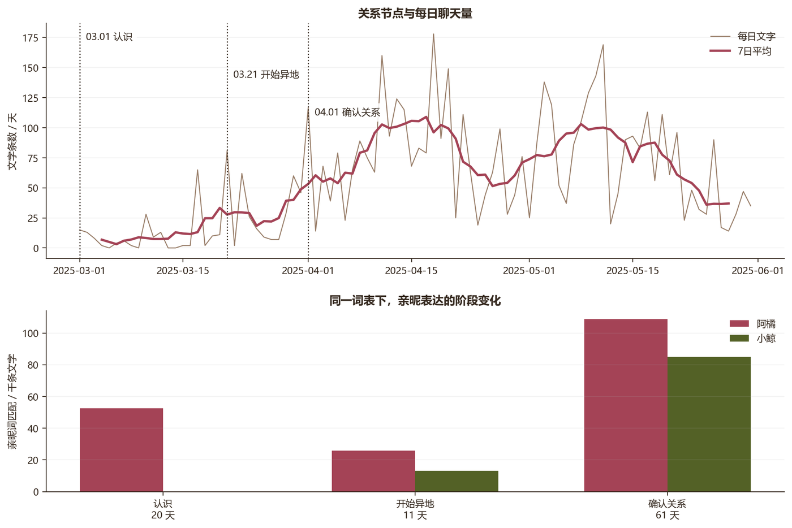
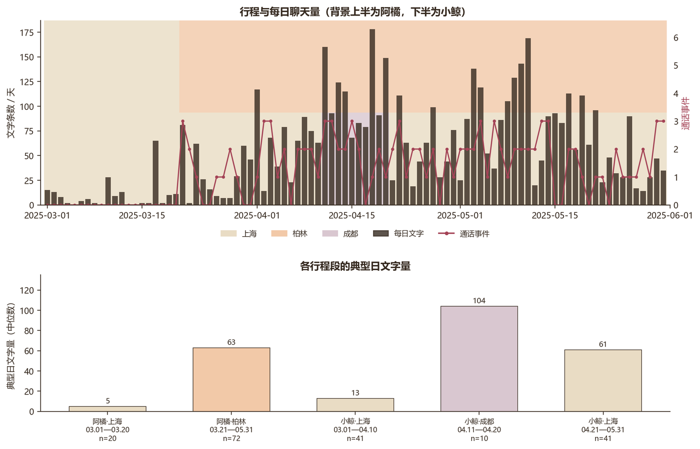
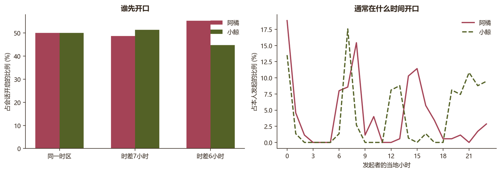
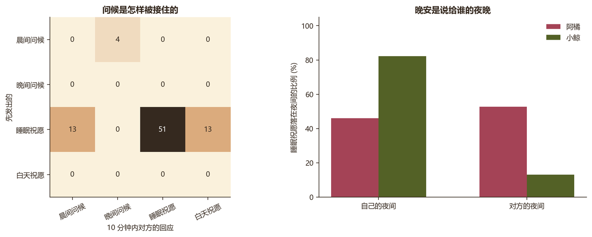
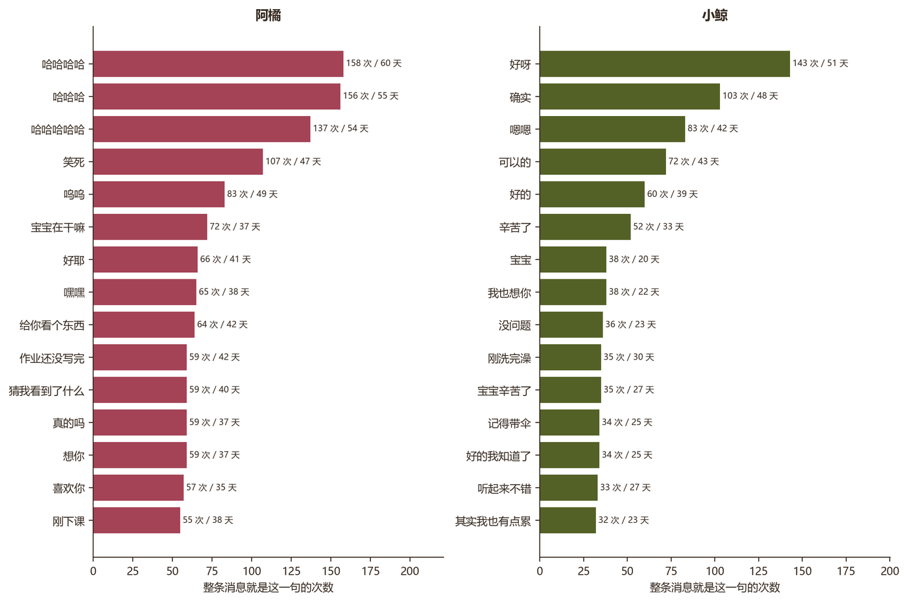
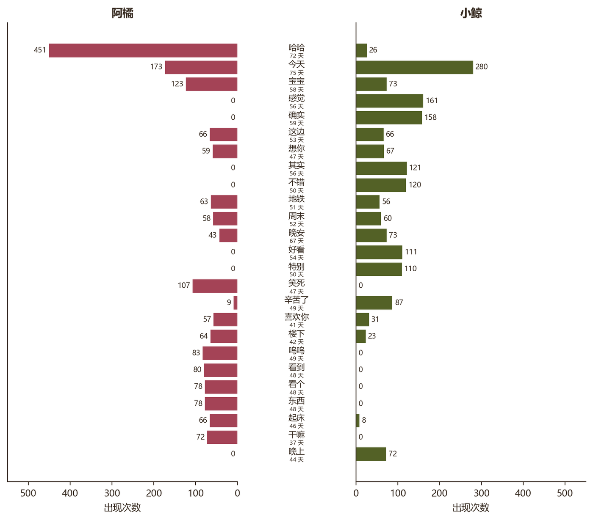
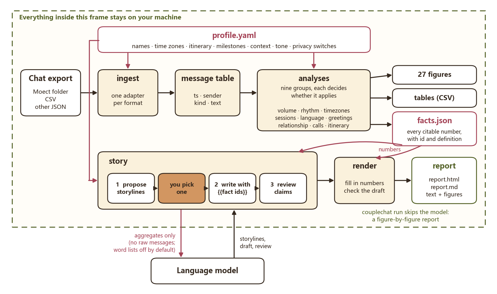

# couplechat

**English** | [中文](README.zh-CN.md)

Turn a two-person chat export into a report that is backed by data and written by a language model.

Every couple is different. Some live in different time zones and some in the same city; some travel a lot; some never call. This project separates three things: the couple's own situation, the general statistics, and the storytelling. Analysing a different couple only takes a different profile file.

The tool was built for Chinese-language WeChat chats, so the word lists, greeting rules, prompts and figure labels are in Chinese. The pipeline itself is language-neutral; see [Extending](#extending).

## Try it in two commands

```bash
pip install -e ".[zh]"
```

```bash
couplechat demo
```

Then open `demo/report.html`. It is a complete report on a fictional couple: 27 figures, each with a sentence saying what it shows. No API key and no data of your own are needed.

## Use it on your own chat

1. **Export the chat.** For WeChat, [Moect](https://github.com/mofan6/Moect) produces a folder this project reads directly. Put the folder under `data/` (ignored by git).
2. **Create your profile.** This looks at the export, lists the senders it finds, and writes a starter file:

```bash
couplechat init data/<export-folder> --format moect --name us
```

3. **Edit `profiles/us.yaml`.** Fill in the two display names and time zones. Milestones, itinerary and background are optional; each one you add switches on more of the analysis.
4. **Run.**

```bash
couplechat --profile profiles/us.yaml --out output/us run data/<export-folder> --format moect
```

Open `output/us/report.html`. This is the figure-by-figure report and calls no model. Nothing has left your machine.

5. **Optional: let the model write the story.** With an Anthropic API key in `ANTHROPIC_API_KEY` and `pip install -e ".[story]"`:

```bash
couplechat --profile profiles/us.yaml --out output/us story
```

```bash
couplechat --profile profiles/us.yaml --out output/us story --pick 1 --review
```

```bash
couplechat --profile profiles/us.yaml --out output/us render
```

The first command proposes two or three storylines; the second writes the one you pick and reviews it; the third produces the final `report.html`. To ask for changes, repeat the second command with `--feedback "Chapter 2 is too long; cut it by half"`.

## Gallery

Every figure below is drawn from fictional data produced by `examples/synthetic/generate.py`. The two people, 阿橘 (A) and 小鲸 (B), do not exist. All 27 figures are listed in [docs/figures.md](docs/figures.md).

**Relationship timeline**: daily chat volume against the relationship milestones, and how often affectionate words appear in each phase.



**Two clocks**: both people's chat hours aligned to the same instant, showing when in each person's day they meet. One panel per time difference.


**Itinerary and chat volume**: the background colour is the city each person was in, the line is call events, and the bars below compare typical days per stay.



<table>
<tr>
<td width="50%"><b>How the chat window settled</b>: share of each week's text by hour; dashed lines mark a change in the time difference.<br></td>
<td width="50%"><b>Who speaks first</b>: share of conversation starts per stage, and the hour each person usually starts at.<br></td>
</tr>
<tr>
<td><b>Whose night is a good night for</b>: which greeting answers which, and whether sleep wishes land in the sender's night or the receiver's.<br></td>
<td><b>Catchphrases</b>: short phrases each person sends as a whole message.<br></td>
</tr>
<tr>
<td><b>Shared words</b>: the most frequent words overall, mirrored for the two people.<br></td>
<td><b>Chat calendar</b>: text messages per day.<br></td>
</tr>
</table>

## Design



- **profile** (`profiles/*.yaml`): everything that differs between couples. Display names, each person's itinerary and time zones, relationship milestones, extra word lists, background supplied by the couple, and the tone of the report.
- **ingest** (`src/couplechat/ingest/`): one adapter per export format, each producing the same message table. Everything downstream reads only that table.
- **analyses** (`src/couplechat/analyses/`): nine groups by function. Each group owns its numbers, figures and tables; it computes and does not interpret. Each group first decides whether it applies to this couple, so a same-city couple gets "timezones: not applied" instead of an error.
- **facts.json**: every number the report may cite, each with an id and a definition. See [docs/facts-schema.md](docs/facts-schema.md).
- **story** (`src/couplechat/story/`, prompts in `prompts/`): three model calls. The first proposes two or three storylines for you to choose from, the second writes the report for the chosen one, and the third reviews it.
- **render** (`src/couplechat/render/`): replaces placeholders with numbers, checks the draft for numbers typed by hand, and writes `report.md` and `report.html`.

### The model never writes numbers

When the model writes the report it does not type numbers. It writes placeholders such as `{{volume.text.A}}`, and the renderer fills them in. Numbers therefore cannot be invented, and the text does not need rewriting when the statistics are rerun. `render` flags unknown ids and hand-typed multi-digit numbers.

## Nine analysis groups, 27 figures

| Group | Question it answers | Figures | Applies when |
|---|---|---|---|
| `volume` | How much was said, by whom, in which media | daily trend, monthly distribution, weekly share, calendar, message types, length and daily balance | always |
| `rhythm` | When in the day and week each person chats | weekday × hour, weekly hours, hourly spread, late night | always |
| `timezones` | When in each person's day the two meet | two clocks, before and after a clock change | the clocks differ on enough days |
| `sessions` | Who starts, how long, how fast the replies | session shape, session starts, reply rhythm, all gaps | always |
| `language` | Each person's catchphrases and the words they share | word clouds, shared words, distinctive words, catchphrases, word lists by week | always (sensitive content) |
| `greetings` | Whose clock a good night follows, and how it is answered | greeting clocks, greeting pairs and good-night direction | enough greetings are matched |
| `relationship` | What changed around the milestones, and how things are lately | phase timeline, recent comparison | the profile has milestones; enough days |
| `calls` | How much happens in calls and not in text | weekly call events | the export has call events |
| `itinerary` | Whether chat volume moves with where someone was | itinerary | the profile lists more than one location |

Figure ids and descriptions are in [docs/figures.md](docs/figures.md). Tables are written to the `tables/` folder next to the report.

## Privacy

A chat history belongs to two people. Make sure both agree before using this.

- **Only aggregates are sent to the model, and only if you run `story`.** `demo` and `run` call no model at all. Raw messages never leave your machine. What is sent is decided by `facts.llm_payload`; you can read `facts.json` first.
- **Word frequencies are not sent by default.** Frequent words and catchphrases are private in themselves. Those facts are flagged `sensitive` and reach the model only if the profile sets `privacy.send_vocabulary: true`.
- **The repository holds no real data.** `.gitignore` excludes `data/`, `output/`, `demo/` and every profile except the example and the starter template. The example data is generated at random by `examples/synthetic/generate.py`; the people and the content are fictional.
- **What you write in the profile is sent.** Display names, milestones, the cities and dates of the itinerary, and the `context` lines (switch them off with `privacy.send_context: false`) go into the model input. Leave out anything you do not want sent.
- **Figures and tables stay on your machine.** Word clouds and catchphrase charts show real words, and the `tables/` folder holds a vocabulary table. Look through them before sharing.
- Whether to share the finished report, and with whom, is up to the two of you.

## Commands

| Command | What it does | Calls a model |
|---|---|---|
| `couplechat demo` | Generates fictional data and builds `demo/report.html` | no |
| `couplechat init EXPORT --format F --name N` | Lists the senders in your export and writes `profiles/N.yaml` | no |
| `couplechat run EXPORT --format F` | Statistics, figures and a figure-by-figure report | no |
| `couplechat analyze EXPORT --format F` | Statistics, figures, tables and `facts.json` only | no |
| `couplechat story` | Proposes storylines; with `--pick N`, writes the report; `--review` checks it; `--offline` uses the fixed template | yes, unless `--offline` |
| `couplechat render` | Fills in numbers and writes `report.md` and `report.html`; `--strict` stops on problems | no |

`--profile` and `--out` go before the command name and default to `profiles/example.yaml` and `output`. The default model is `claude-opus-5-5`; change it in the profile under `story.model`. Requests enable server-side fallback: if the model declines a request, the API retries it on a fallback model.

### Supported export formats

| `--format` | Source | Notes |
|---|---|---|
| `moect` | WeChat history exported with [Moect](https://github.com/mofan6/Moect) | Pass the export folder. Senders are reported as `self` (the exporting account) and `other`; `init` fills these in for you |
| `csv` | Generic CSV | Four columns: `timestamp, sender, kind, text`. The easiest target to convert other tools' output into |
| `wechat-json` | JSON from other tools | A template; adjust the field names to your tool |

This project only reads files you have exported yourself. It does not export chat histories and is not responsible for that step; follow the export tool's own instructions and licence.

## Extending

- **A new export format**: write a function in `ingest/` that returns the four columns `ts, sender, kind, text`, and register it in `ADAPTERS`.
- **A new analysis group**: add a file under `analyses/` with `run(ctx)`. Start by calling `ctx.facts.module(name, applied, reason)` to say whether it applies, add numbers with `ctx.facts.add(...)`, and append the module to `ANALYSES` in `analyses/__init__.py`.
- **A new figure**: draw it inside its group and call `ctx.figure(fig, id, title, group, shows)`. `shows` is the one-sentence description the model reads and the report prints under the figure.
- **New word lists or greeting rules**: edit the files under `lexicons/`, or add to `lexicons` in the profile.
- **Another tone or language**: change `story.tone` and `story.language` in the profile, or edit the prompts under `prompts/`. For a non-Chinese chat you will also want to replace the word lists, the greeting rules and the stop words under `lexicons/`.

## Tests

```bash
pip install -e ".[dev]"
```

```bash
pytest
```

The tests use synthetic data only and make no network calls.

## Known limitations

- Figure labels, word lists, greeting rules and prompts are in Chinese.
- The project must be installed from a checkout with `pip install -e`, because it reads its prompts and word lists from the repository folder.
- The model-written report is Markdown and simple HTML; LaTeX layout is not implemented.
- Without `jieba` (installed by the `zh` extra), Chinese word counts fall back to overlapping two-character pieces and the language figures become rough.
- A time difference that is not a whole number of hours (5.5, for example) is rounded when the two clocks are aligned.
- The `moect` adapter follows the file structure Moect produces today and may need updating if that tool changes its format. The `wechat-json` adapter is only a template.
- Call events usually carry only a timestamp, with no duration and no connection status.

## Licence

MIT
