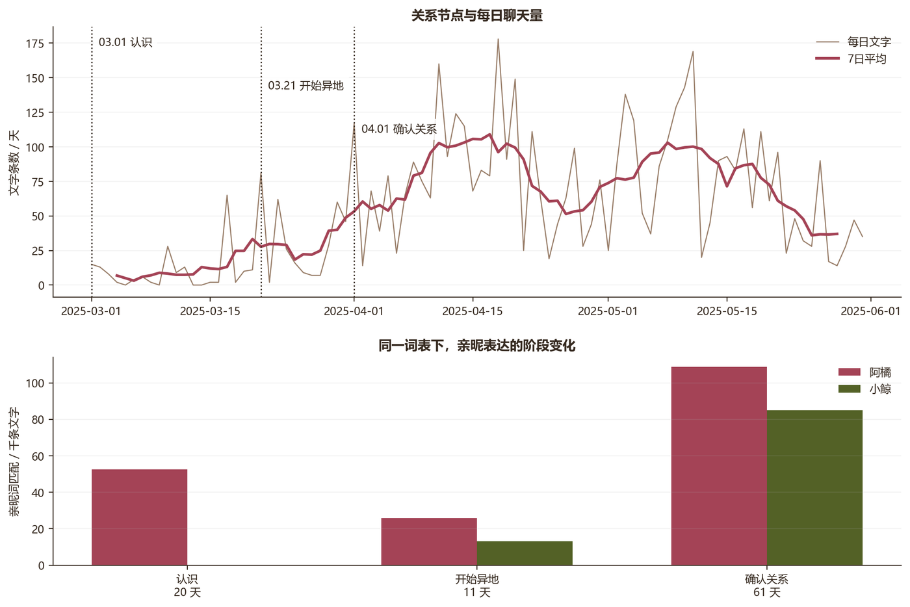
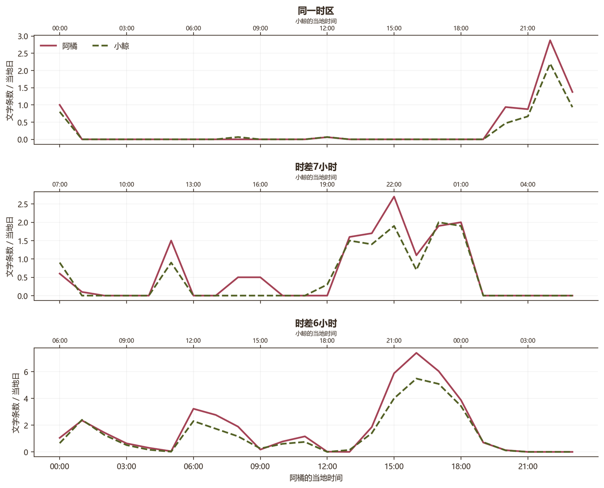
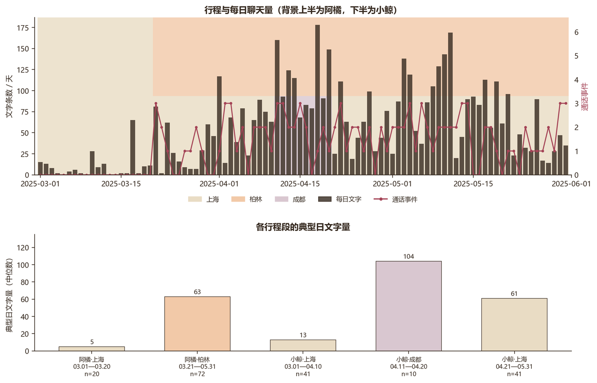
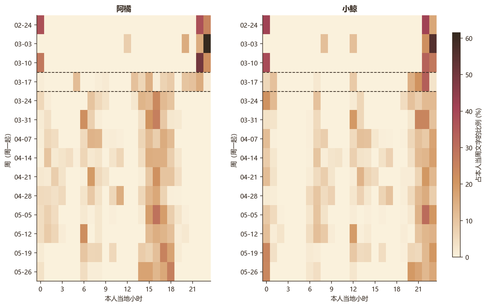
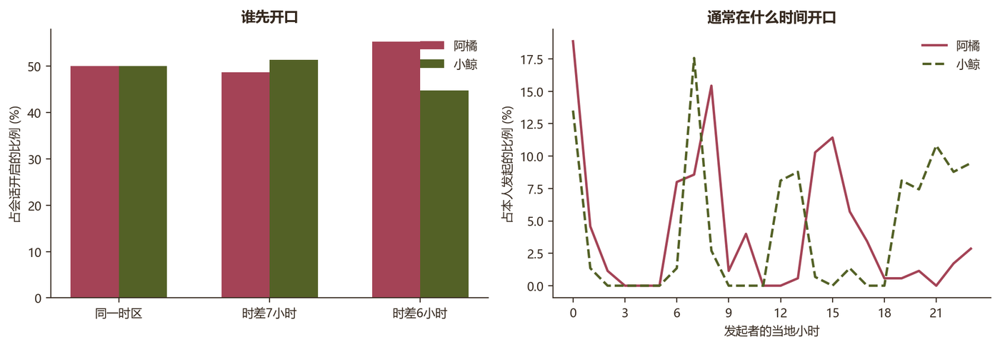
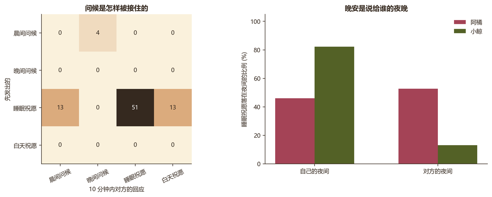
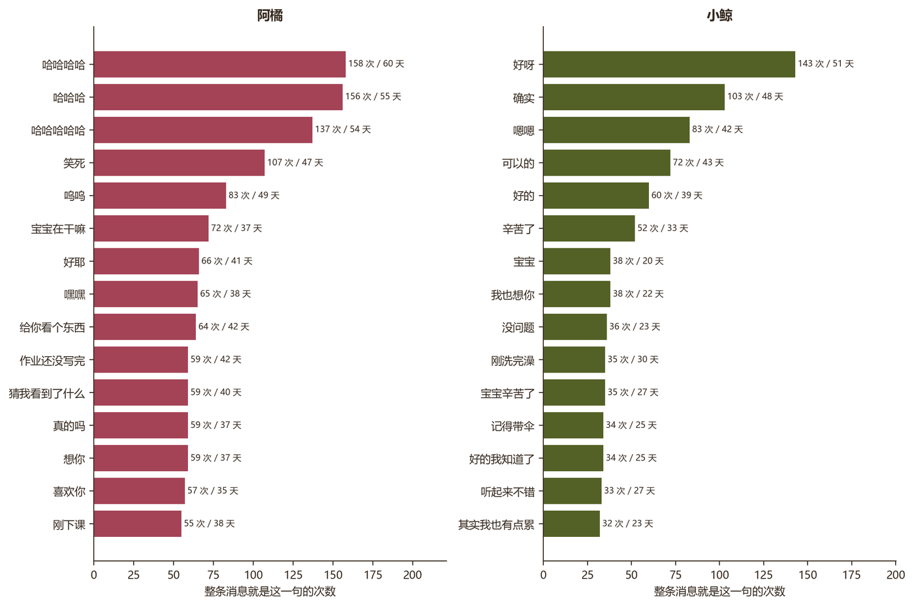
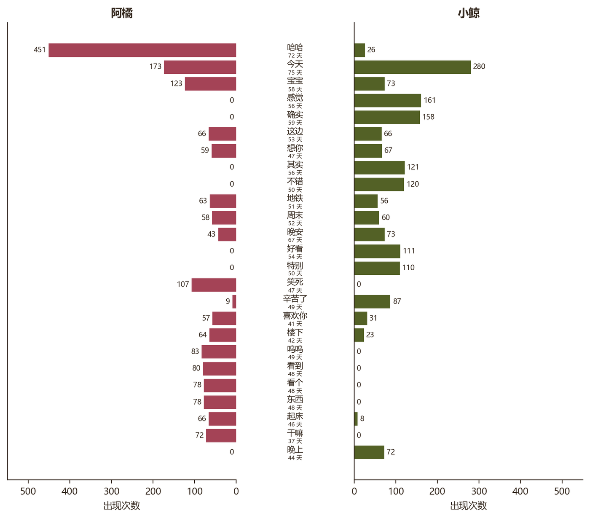
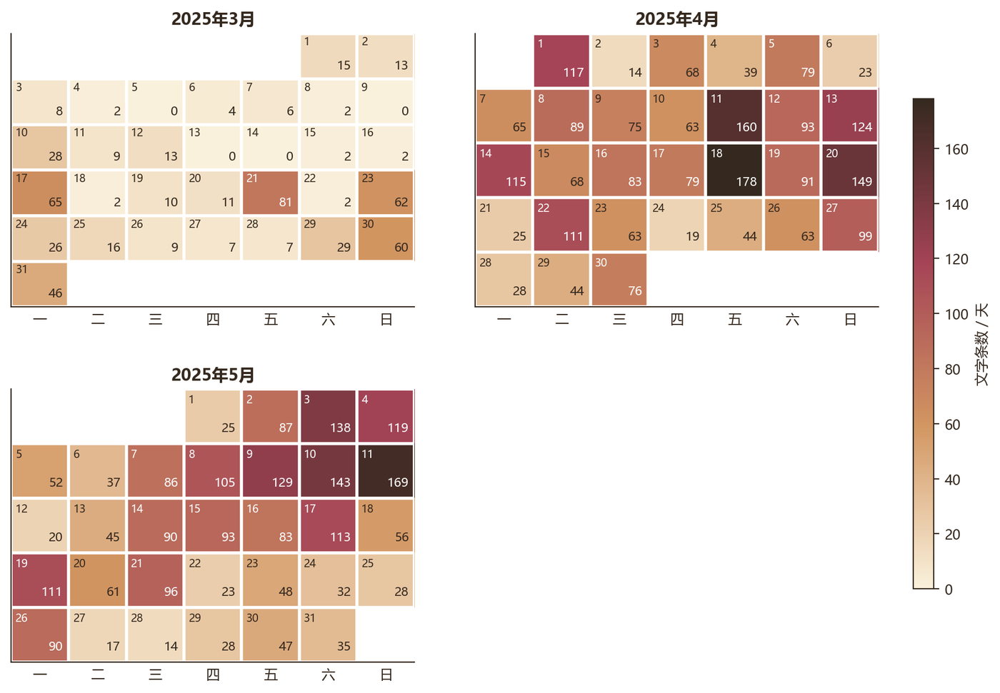
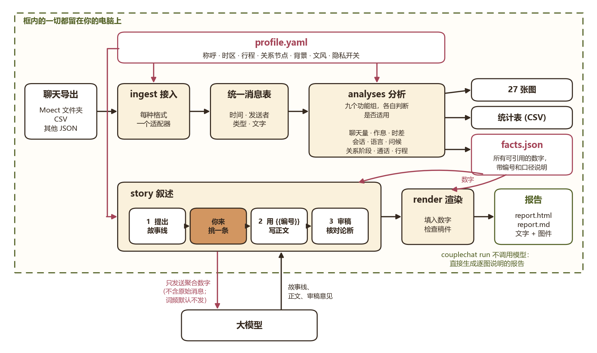

# couplechat

[English](README.md) | **中文**

把两个人的聊天导出，变成一份有数据依据、由大模型执笔的报告。

每对情侣的情况都不一样：有人异地跨时区，有人同城；有人常出差，有人不打电话。这个项目把“这对情侣的情况”“通用的统计方法”和“怎么讲故事”分成三层，换一对情侣只需要换一份配置。

## 两条命令先看效果

```bash
pip install -e ".[zh]"
```

```bash
couplechat demo
```

然后打开 `demo/report.html`。这是一份关于虚构情侣的完整报告：27 张图，每张图下面有一句话说明它能看出什么。不需要 API 密钥，也不需要自己的数据。

## 用在自己的聊天记录上

1. **导出聊天记录。** 微信可以用 [Moect](https://github.com/mofan6/Moect) 导出，本项目能直接读取它生成的文件夹。把文件夹放进 `data/`（不会进 git）。
2. **生成配置。** 这一步会查看导出、列出其中的发送者，并写出一份起步用的配置：

```bash
couplechat init data/<导出文件夹> --format moect --name us
```

3. **修改 `profiles/us.yaml`。** 填上两个人的称呼和时区。关系节点、行程和背景是可选的，每多填一项，就多启用一部分分析。
4. **运行。**

```bash
couplechat --profile profiles/us.yaml --out output/us run data/<导出文件夹> --format moect
```

打开 `output/us/report.html`。这是逐图说明的图表版报告，不调用任何模型，到这一步没有任何内容离开你的电脑。

5. **可选：让大模型来写故事。** 需要把 Anthropic API 密钥放进环境变量 `ANTHROPIC_API_KEY`，并运行 `pip install -e ".[story]"`：

```bash
couplechat --profile profiles/us.yaml --out output/us story
```

```bash
couplechat --profile profiles/us.yaml --out output/us story --pick 1 --review
```

```bash
couplechat --profile profiles/us.yaml --out output/us render
```

第一条命令提出两三条候选故事线；第二条按你挑的那条写正文并审稿；第三条生成最终的 `report.html`。想修改时，重复第二条命令并加上 `--feedback "第二章太长，压缩一半"`。

## 效果图

下面的图全部由 `examples/synthetic/generate.py` 生成的虚构数据画出，人物“阿橘”和“小鲸”并不存在。全部 27 张图的说明见 [docs/figures.zh-CN.md](docs/figures.zh-CN.md)。

**关系时间线**：每日聊天量与关系节点，以及各阶段的亲昵词出现率。



**两套时钟**：把两人的聊天时段对齐到同一时刻，看他们在各自一天的什么时候相遇。每种时差一栏。



**行程与聊天量**：背景色是各自所在的城市，折线是通话事件，下方的柱比较各段停留期间的典型日。



<table>
<tr>
<td width="50%"><b>聊天时段是怎样固定下来的</b>：每周文字在各小时的占比，虚线为时差变化。<br></td>
<td width="50%"><b>谁先开口</b>：各阶段两人开启会话的比例，以及各自通常在什么时间开口。<br></td>
</tr>
<tr>
<td><b>晚安是说给谁的夜晚</b>：哪种问候接哪种问候，以及睡眠祝愿落在发送者还是接收者的夜间。<br></td>
<td><b>口头禅</b>：各自单独发出的整句短语。<br></td>
</tr>
<tr>
<td><b>共同的词</b>：合计最常用的词在两人各自的出现次数。<br></td>
<td><b>聊天日历</b>：每天的文字条数。<br></td>
</tr>
</table>

## 设计



- **profile**（`profiles/*.yaml`）：因人而异的一切。两人的显示名、每人的行程与时区、关系节点、自定义词表、当事人补充的背景、文风。
- **ingest**（`src/couplechat/ingest/`）：每种导出格式一个适配器，输出统一的消息表。后面的代码只认这张表。
- **analyses**（`src/couplechat/analyses/`）：按功能分成九组，每组负责自己的数字、图件和表格，只计算，不解读。每组先判断自己是否适用于这对情侣；同城情侣会得到“时差：未启用”，而不是报错。
- **facts.json**：报告可以引用的全部数字，每个数字有编号和口径说明。格式见 [docs/facts-schema.zh-CN.md](docs/facts-schema.zh-CN.md)。
- **story**（`src/couplechat/story/`，提示词在 `prompts/`）：三次模型调用。先提出两三条候选故事线，由你挑选；再按选定的故事线写正文；最后审稿。
- **render**（`src/couplechat/render/`）：把占位符换成数字，检查正文里有没有手写的数字，并输出 `report.md` 和 `report.html`。

### 数字不由模型书写

模型写正文时不直接写数字，只写占位符，例如 `共发出 {{volume.text.A}} 条文字`，由渲染程序填入。这样数字不会被编造，重新统计后正文也不必重写。`render` 会标出未知的编号和手写的多位数字。

## 九个功能组，27 张图

| 功能组 | 回答的问题 | 图件 | 适用条件 |
|---|---|---|---|
| `volume` 聊天量与对称性 | 聊了多少、谁说得多、用什么媒介 | 每日趋势、月度分布、逐周占比、日历、消息类型、单条长度与每日字数 | 总是 |
| `rhythm` 作息节奏 | 各自在一天、一周的什么时候聊 | 星期×小时、逐周小时分布、小时均值与波动、深夜比例 | 总是 |
| `timezones` 两套时钟 | 两人在各自一天的什么时候相遇 | 双时钟对照、时差变化前后 | 时钟不同的天数足够多 |
| `sessions` 会话与回应 | 谁先开口、聊多久、接话多快 | 会话形态、会话发起、接话节奏、完整等待分布 | 总是 |
| `language` 语言 | 各自的口头禅、共同的词 | 词云、共同高频词、特征词、完整短句、词组逐周出现率 | 总是（内容敏感） |
| `greetings` 问候 | 早安晚安按谁的时间发、怎样被接住 | 问候的双时钟分布、问候配对与晚安方向 | 匹配到足够多的问候 |
| `relationship` 关系阶段 | 关系节点前后有什么变化、最近怎样 | 阶段时间线、近期等长窗口对照 | profile 有关系节点；天数足够 |
| `calls` 通话 | 文字之外有多少通话 | 逐周通话事件 | 导出里有通话事件 |
| `itinerary` 行程 | 聊天量是否随所在城市起伏 | 行程与聊天量 | profile 有多段行程 |

每张图的编号和说明见 [docs/figures.zh-CN.md](docs/figures.zh-CN.md)。统计表输出在报告旁边的 `tables/` 文件夹里。

## 隐私

聊天记录属于两个人。使用前请确认双方都同意。

- **只有运行 `story` 时才会向模型发送内容，而且只发送聚合统计。** `demo` 和 `run` 完全不调用模型。原始消息不离开本机；发送内容由 `facts.llm_payload` 决定，可以先打开 `facts.json` 看一遍。
- **词频默认不发送。** 高频词和口头禅本身就是隐私，相关 facts 标记为 `sensitive`，只有在 profile 里设置 `privacy.send_vocabulary: true` 才会进入模型输入。
- **仓库里没有真实数据。** `.gitignore` 排除了 `data/`、`output/`、`demo/`，以及除示例和起步模板外的所有 profile。示例数据由 `examples/synthetic/generate.py` 随机生成，人物与内容均为虚构。
- **profile 里的内容会被发送。** 显示名、关系节点、行程中的城市和日期，以及 `context` 里的背景（可用 `privacy.send_context: false` 关闭）会进入模型输入。不想发送的信息不要写进 profile。
- **图件和表格留在本机。** 词云、口头禅等图件会显示真实的词，`tables/` 里有词频表；分享前请自己过目。
- 报告生成后是否分享、分享给谁，由你们自己决定。

## 命令一览

| 命令 | 作用 | 是否调用模型 |
|---|---|---|
| `couplechat demo` | 生成虚构数据并产出 `demo/report.html` | 否 |
| `couplechat init 导出 --format F --name N` | 列出导出里的发送者，写出 `profiles/N.yaml` | 否 |
| `couplechat run 导出 --format F` | 统计、图件和逐图说明的报告 | 否 |
| `couplechat analyze 导出 --format F` | 只做统计、图件、表格和 `facts.json` | 否 |
| `couplechat story` | 提出故事线；加 `--pick N` 写正文；`--review` 审稿；`--offline` 使用固定模板 | 是（`--offline` 除外） |
| `couplechat render` | 填入数字，输出 `report.md` 和 `report.html`；`--strict` 遇到问题即停 | 否 |

`--profile` 和 `--out` 写在命令名之前，默认分别是 `profiles/example.yaml` 和 `output`。默认模型为 `claude-opus-5-5`，可在 profile 的 `story.model` 中修改。请求启用了服务端回退：如果模型拒绝某次请求，API 会自动在备用模型上重试。

### 支持的导出格式

| `--format` | 来源 | 说明 |
|---|---|---|
| `moect` | [Moect](https://github.com/mofan6/Moect) 导出的微信聊天记录 | 传入导出文件夹。发送者记为 `self`（导出者本人）和 `other`，`init` 会替你填好 |
| `csv` | 通用 CSV | 四列：`timestamp, sender, kind, text`；最容易从其他工具转换过来 |
| `wechat-json` | 其他工具的 JSON | 模板，字段名需要按你使用的工具调整 |

本项目只读取你自己导出的文件，不包含也不负责导出聊天记录；导出工具的使用请遵循其自身的说明和许可。

## 扩展

- **新的导出格式**：在 `ingest/` 里写一个返回 `ts, sender, kind, text` 四列的函数，并登记到 `ADAPTERS`。
- **新的功能组**：在 `analyses/` 里新建一个文件，写 `run(ctx)`：开头用 `ctx.facts.module(name, applied, reason)` 说明是否适用，再用 `ctx.facts.add(...)` 添加数字，并把它加进 `analyses/__init__.py` 的 `ANALYSES`。
- **新的图**：在所属功能组里画好后调用 `ctx.figure(fig, 编号, 标题, 组名, shows)`。其中的 `shows` 是一句话说明，模型会读它，报告里也会印在图的下方。
- **新的词表或问候规则**：改 `lexicons/` 下的文件，或在 profile 的 `lexicons` 里追加。
- **新的文风或语言**：改 profile 里的 `story.tone` 和 `story.language`，或直接改 `prompts/` 下的提示词。

## 测试

```bash
pip install -e ".[dev]"
```

```bash
pytest
```

测试只使用合成数据，不联网。

## 已知限制

- 必须在仓库目录里用 `pip install -e` 安装，因为程序要从仓库文件夹读取提示词和词表。
- 模型写的报告是 Markdown 和简单的 HTML；LaTeX 排版尚未实现。
- 没有安装 `jieba`（`zh` 附加项会安装它）时，中文词频退化为相邻两字切分，语言组的图会很粗糙。
- 非整点时差（如 5.5 小时）在双时钟图中按四舍五入对齐。
- `moect` 适配器依据 Moect 导出的文件结构编写；该工具更新格式后可能需要同步调整。`wechat-json` 适配器只是模板。
- 通话事件通常只有时间戳，没有时长和接通状态。

## 许可

MIT
